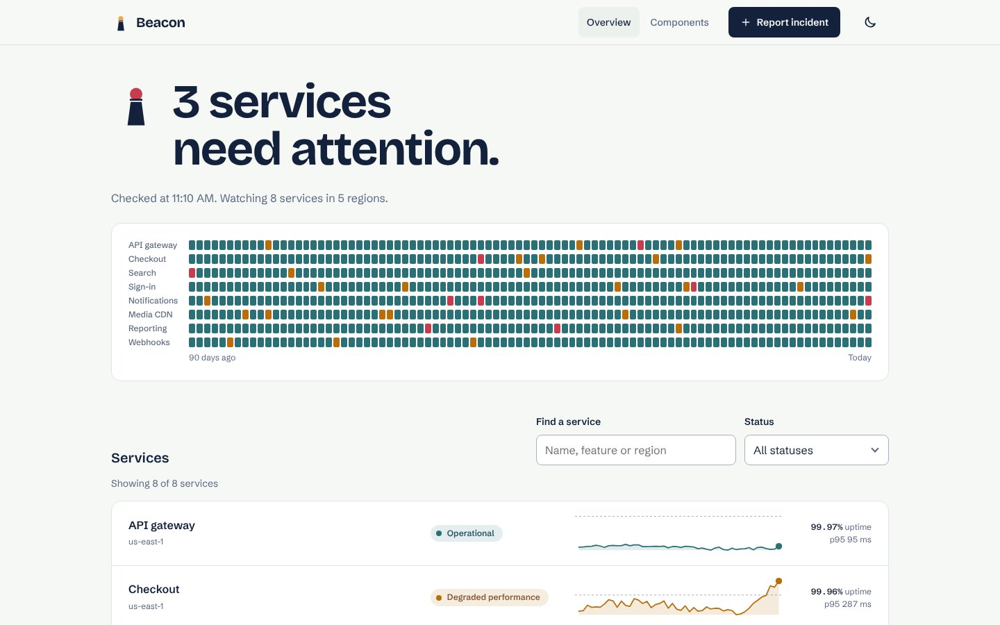
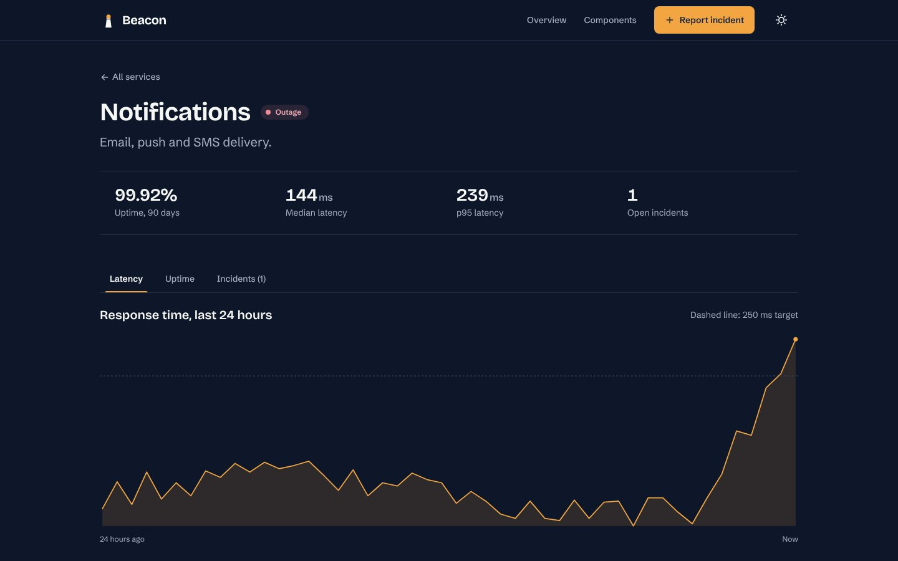

# Beacon UI

**[🇪🇸 Leer en español](./README.es.md)**

A design system of framework-agnostic **Web Components built with Lit 3**, and the service status console that uses it: uptime, latency, incidents and an incident report form.



> **Status: `0.1.0`, front end only.** Data comes from a mock API in `src/app/data` that simulates network latency and cancellation, so the views already handle loading, errors and aborts. Replacing that module with real `fetch` calls is the only step to connect a backend.

## Contents

- [Why Web Components](#why-web-components)
- [Tech stack](#tech-stack)
- [Quick start](#quick-start)
- [Scripts](#scripts)
- [What is in the app](#what-is-in-the-app)
- [Design system](#design-system)
- [Project structure](#project-structure)
- [Conventions](#conventions)
- [Testing and quality](#testing-and-quality)
- [Accessibility](#accessibility)
- [Deployment](#deployment)

## Why Web Components

The components are custom elements defined by the browser, not by a framework. The same `<bc-button>` or `<bc-text-field>` works in plain HTML, React 19, Angular, Vue or a server-rendered page, which is what a design system shared by several teams needs. Lit adds reactive properties and efficient templates on top of the standard, at about 5 kB.

## Tech stack

| Area       | Choice                                                                                    |
| ---------- | ----------------------------------------------------------------------------------------- |
| Components | Lit 3.3 (`static properties`, no decorators)                                              |
| State      | `@lit/context` for dependency injection, a framework-free observable store                |
| Async data | `@lit/task` (loading, error and abort handled per view)                                   |
| Language   | TypeScript 6, `strict` plus `exactOptionalPropertyTypes` and `noUncheckedIndexedAccess`   |
| Styles     | SCSS (tokens, mixins, per-component stylesheets) compiled into each shadow root           |
| Build      | Vite 8                                                                                    |
| Tests      | Vitest 5 browser mode on real Chromium (Playwright), axe-core                             |
| Lint       | ESLint (typescript-eslint strict, lit, wc, lit-a11y), Stylelint (standard SCSS), Prettier |
| Docs       | Custom Elements Manifest (`custom-elements.json`)                                         |
| CI/CD      | GitHub Actions, deployed to GitHub Pages                                                  |

## Quick start

Requirements: Node.js 22 or later and [pnpm](https://pnpm.io).

```bash
pnpm install
pnpm exec playwright install chromium   # once, for the browser tests
pnpm dev
```

Open <http://localhost:5173>. No environment variables are needed.

## Scripts

| Script                         | What it does                                    |
| ------------------------------ | ----------------------------------------------- |
| `pnpm dev`                     | Development server                              |
| `pnpm build`                   | Type-check and production build                 |
| `pnpm preview`                 | Serve the production build                      |
| `pnpm lint`                    | ESLint and Stylelint                            |
| `pnpm typecheck`               | `tsc --noEmit`                                  |
| `pnpm format` / `format:check` | Prettier                                        |
| `pnpm test`                    | Every test, in headless Chromium                |
| `pnpm test:coverage`           | Same, with coverage and thresholds (90 % lines) |
| `pnpm analyze`                 | Generates `custom-elements.json`                |

Before finishing any change, run `lint`, `typecheck`, `test` and `build`.

## What is in the app

| Route            | Page                                                                                                           |
| ---------------- | -------------------------------------------------------------------------------------------------------------- |
| `#/`             | Overview: one-sentence status, the 90-day uptime of every service, a filterable list and the incident timeline |
| `#/services/:id` | Service detail: uptime and latency figures, tabs for latency, uptime and incidents                             |
| `#/report`       | Incident report form (accepts `?service=`)                                                                     |
| `#/components`   | Living style guide with every component                                                                        |

Reported incidents change the status of their service immediately, persist in `sessionStorage`, and can be resolved from the service page after a confirmation dialog.



## Design system

Fifteen elements, all prefixed `bc-`:

| Element                                                    | Highlights                                                                                                                                                   |
| ---------------------------------------------------------- | ------------------------------------------------------------------------------------------------------------------------------------------------------------ |
| `bc-button`                                                | Variants and sizes; renders a link with `href`; form-associated, so `type="submit"` works from inside a shadow root                                          |
| `bc-text-field`, `bc-select`, `bc-switch`                  | Form-associated custom elements (`ElementInternals`): they appear in `FormData`, block invalid submits, reset with the form and follow `<fieldset disabled>` |
| `bc-tabs`, `bc-tab-panel`                                  | WAI-ARIA tabs pattern: roving tabindex, arrows, Home and End                                                                                                 |
| `bc-dialog`                                                | Native `<dialog>` modal: focus trap, Escape and top layer come from the browser                                                                              |
| `bc-toast-region`                                          | Polite live region, queue limit, auto-dismiss                                                                                                                |
| `bc-sparkline`, `bc-uptime-bar`                            | SVG charts with a text summary for screen readers                                                                                                            |
| `bc-badge`, `bc-card`, `bc-stat`, `bc-icon`, `bc-skeleton` | Building blocks                                                                                                                                              |

**Tokens.** `src/design-system/styles` defines the palette, type scale, spacing and two themes as SCSS maps, and emits them as CSS custom properties on `:root`. Custom properties inherit through shadow roots, so every component reads the current theme without importing anything, and switching theme needs no rebuild. Components only read the semantic layer (`--bc-color-text`, `--bc-color-outage`), never the raw palette.

**Styles per component.** Each component has its own `.scss` file that `@use`s the shared mixins (`host-base`, `focus-ring`, `touch-target`, `tone-variants`, `type()`…). Vite compiles it at build time and the component adopts it with `unsafeCSS`; because the input is a static file in the repo, never user content, this is safe. Deprecated Sass features fail the build.

## Project structure

```text
src/
  design-system/          Framework-agnostic, publishable on its own
    styles/               Palette, foundations, themes, mixins, tokens.scss
    shared/               defineElement, FormControl base class, field helpers
    components/<Name>/    One folder per component
  app/                    The status console built with the design system
    data/                 Mock API, seeded data generator, types
    core/                 router, store, theme, format, status, events
    parts/                App components shared by views (ServiceRow, IncidentList…)
    shell/                AppRoot (router, context provider, toasts) and AppHeader
    views/                One folder per route
    styles/               Layout mixins and light-DOM global styles
    test/                 App flow and accessibility tests
  test/                   Shared test setup and fixtures
```

Every component follows the same layout:

```text
components/TextField/
  TextField.ts            Element class (named export) and registration
  TextField.types.ts      Every type, plus the HTMLElementTagNameMap entry
  TextField.constants.ts  Every constant, including the tag name
  TextField.utils.ts      Pure logic
  TextField.scss          Styles
  TextField.test.ts       Browser tests
  index.ts                Public exports
```

The reasoning behind the main decisions is in [`ARCHITECTURE.md`](./ARCHITECTURE.md).

## Conventions

- **Language:** code, comments, docs and commits in English.
- **Constants and types** never live in the element file: constants go in `X.constants.ts`, types in `X.types.ts`. Functions are documented with JSDoc.
- **Complexity** of every function stays at 10 or less (ESLint `complexity`, same metric as Code Metrics).
- **No deprecated APIs:** `@typescript-eslint/no-deprecated` is an error, and so are deprecated Sass features.
- **No decorators.** Properties are declared with `static properties` and `declare` fields, so the code is standard JavaScript that does not depend on a decorator transform.
- **Lifecycle methods only call named methods;** the logic lives in utils or private methods.
- **Accessibility is part of the component:** roles, keyboard support, visible focus and 44 px touch targets.
- **Git:** conventional commits, one per component or feature.

## Testing and quality

Tests run in **real Chromium** through Vitest browser mode, not in jsdom: Shadow DOM, `ElementInternals`, `<dialog>`, focus and keyboard events behave exactly as users get them.

- **Unit tests** for every pure function (charts maths, router, store, formatting).
- **Component tests** for every element: rendering, ARIA, keyboard, events and native form participation.
- **App flow tests**: load the overview, filter, report an incident end to end, invalid submit, unknown routes, focus after navigation.
- **Accessibility tests**: axe-core on every page in both themes, against WCAG 2.2 AA. Zero violations.

182 tests; about 92 % of statements are covered, with thresholds enforced in CI.

## Accessibility

Skip link, landmarks, one `h1` per page, focus moved to the main region on navigation, document titles per page, form errors announced and linked with `aria-describedby`, errors shown after the first blur or submit rather than while typing, `prefers-reduced-motion` respected, both themes checked for contrast, charts with text alternatives, and no information carried by colour alone.

## Deployment

`pnpm build` writes a static site to `dist/`. Routing uses the URL hash, so no server rewrites are needed. On every push to `main`, the CI workflow lints, type-checks, runs the browser tests, builds with `BASE_PATH=/beacon-ui/` and deploys to GitHub Pages (enable it under **Settings → Pages → Source: GitHub Actions**).

## Author

**Jhon David Toro Muriel** · [GitHub](https://github.com/Jhon-David-Toro) · [portfolio.doxel.dev](https://portfolio.doxel.dev)
